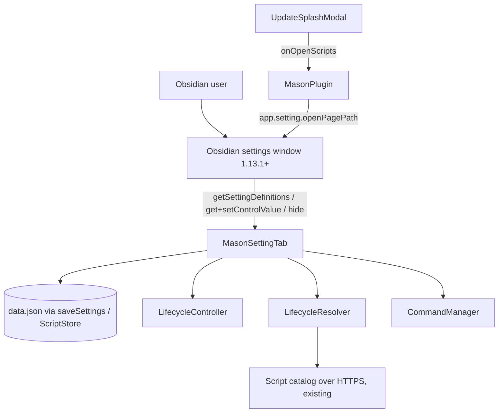
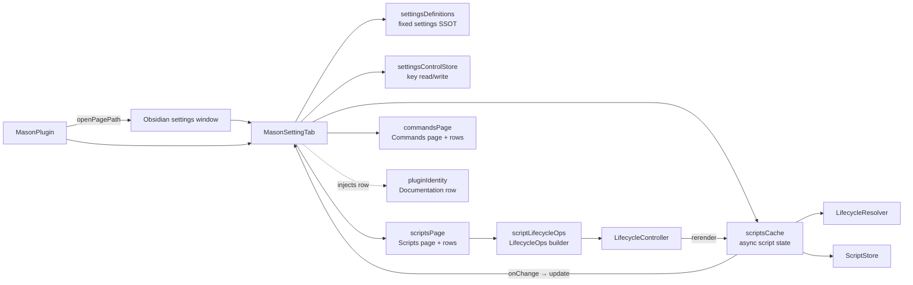
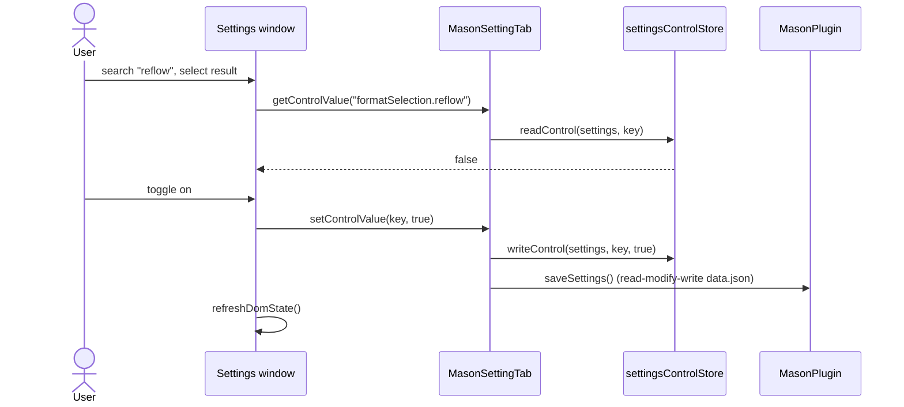

# Solution Design Document

## Validation Checklist

### CRITICAL GATES (Must Pass)

- [x] All required sections are complete
- [x] No [NEEDS CLARIFICATION] markers remain
- [x] Architecture pattern is clearly stated with rationale
- [x] **All architecture decisions confirmed by user** (ADR-1–8, 2026-11-21)
- [x] Every interface has specification

### QUALITY CHECKS (Should Pass)

- [x] All context sources are listed with relevance ratings
- [x] Project commands are discovered from actual project files
- [x] Constraints → Strategy → Design → Implementation path is logical
- [x] Every component in diagram has directory mapping
- [x] Error handling covers all error types
- [x] Quality requirements are specific and measurable
- [x] Component names consistent across diagrams
- [x] A developer could implement from this design
- [x] Implementation examples use actual schema column names (not pseudocode), verified against migration files. N/A: no database. Examples use the real `MasonSettings` / `FormatSelectionRecipe` field names from src/core/types.ts.
- [x] Complex queries include traced walkthroughs with example data showing how the logic evaluates (control-key resolution and the scripts-cache refresh are traced)

---

## Output Schema

### SDD Status Report

| Field | Type | Required | Description |
|-------|------|----------|-------------|
| specId | string | Yes | Spec identifier (NNN-name format) |
| architecture | ArchitectureSummary | Yes | Architecture overview |
| sections | SectionStatus[] | Yes | Status of each SDD section |
| adrs | ADRStatus[] | Yes | Architecture decision statuses |
| validationPassed | number | Yes | Validation items passed |
| validationPending | number | Yes | Validation items pending |
| nextSteps | string[] | Yes | Recommended next actions |

### ArchitectureSummary

| Field | Type | Required | Description |
|-------|------|----------|-------------|
| pattern | string | Yes | Selected architecture pattern |
| keyComponents | string[] | Yes | Main system components |
| externalIntegrations | string[] | No | External services integrated |

### SectionStatus

| Field | Type | Required | Description |
|-------|------|----------|-------------|
| name | string | Yes | Section name |
| status | enum: `COMPLETE`, `NEEDS_DECISION`, `IN_PROGRESS` | Yes | Current state |
| detail | string | No | What decision is needed or what's in progress |

### ADRStatus

| Field | Type | Required | Description |
|-------|------|----------|-------------|
| id | string | Yes | ADR identifier (e.g., ADR-1) |
| name | string | Yes | Decision name |
| status | enum: `CONFIRMED`, `PENDING` | Yes | Confirmation state |

---

## Constraints

- **CON-1 Platform:** Obsidian desktop, `minAppVersion` **1.13.1** (ADR-1). TypeScript, bundled to CJS with esbuild; vitest 4 for tests; `obsidian` typings package 1.13.1. `isDesktopOnly: true` is unchanged.
- **CON-2 Declarative API rules** (verified in the 1.15.1 runtime bundle and the typings):
  - `getSettingDefinitions()` must be synchronous and cheap (no I/O). It must never return `[]`, because an empty array falls back to `display()`, which is deleted.
  - Groups cannot nest; the runtime drops a nested group silently.
  - Search indexes only `name`, `desc` text and `aliases`. A page entry is matched by its `name` only.
  - List `extraButtons`/`addItem` are wired once, when the group is created.
  - `update()` re-renders the visible page in place (keyed diff; scroll and the focused control are kept).
- **CON-3 Data integrity:** `data.json` holds both the `MasonSettings` fields and the `scripts` namespace (ScriptStore). The base `PluginSettingTab.setControlValue` runs `plugin.saveData(plugin.settings)`, which would drop the `scripts` namespace. Every write must go through `plugin.saveSettings()`, the existing read-modify-write.
- **CON-4 Repo standards:** sentence case for all UI text; no `innerHTML` or other HTML sinks (static scan in test/ui/xss.test.ts); `obsidianmd/*` rules cannot be disabled inline; one feature per change; tests before code (TDD); never `npm run build` while a dev vault is under test.

## Implementation Context

**IMPORTANT**: You MUST read and analyze ALL listed context sources to understand constraints, patterns, and existing architecture.

### Required Context Sources

#### Documentation Context
```yaml
- doc: docs/XDD/specs/010-settings-search/requirements.md
  relevance: CRITICAL
  why: "Approved PRD: 10 features, 38 acceptance criteria"
- doc: docs/XDD/specs/010-settings-search/README.md
  relevance: HIGH
  why: "Decisions log (Path A, layout, scripts list, scope)"
- doc: docs/configuration.md, docs/installation.md, README.md
  relevance: MEDIUM
  why: "User docs to rewrite for the new layout (Feature 10)"
- url: https://docs.obsidian.md/Plugins/User+interface/Settings
  relevance: HIGH
  why: "Declarative settings API, style guide"
- url: https://docs.obsidian.md/plugins/guides/migrate-declarative-settings
  relevance: HIGH
  why: "Path A migration guidance"
```

#### Code Context
```yaml
- file: node_modules/obsidian/obsidian.d.ts
  relevance: CRITICAL
  why: "SettingTab/PluginSettingTab 1.13 members (~L5149-5175, L6549-6650); SettingDefinition*/SettingControl* types (~L5866-6720)"
- file: src/ui/settingsTab.ts
  relevance: CRITICAL
  why: "Current 731-line segmented tab; source of every name/desc string (L233-294, 521-707, 716-728)"
- file: src/ui/scriptsTab.ts
  relevance: HIGH
  why: "State→pill/toggle/menu/recovery mapping (L143-349, 389-391) to reuse verbatim"
- file: src/ui/commandsTab.ts
  relevance: HIGH
  why: "Per-script command row handlers (L99-153) to reuse"
- file: src/ui/pluginIdentity.ts
  relevance: MEDIUM
  why: "REPO_URL and parseAuthorName (moved here from HeaderSection.ts in T1.3); Documentation row"
- file: src/main.ts
  relevance: HIGH
  why: "onload order (L176-181), saveSettings/pickSettingsFields (L531-541, L925-934), splash (L382-456), resolver/controller wiring (L217-263)"
- file: src/core/types.ts, src/core/formatSelection.ts
  relevance: HIGH
  why: "MasonSettings, DEFAULT_SETTINGS, FormatSelectionRecipe, resolveFormatSelectionRecipe (defaults without duplication)"
- file: src/scripts/store.ts, src/scripts/lifecycleResolver.ts, src/scripts/lifecycleController.ts
  relevance: HIGH
  why: "Async script data and the rerender callback the cache replaces"
- file: test/__mocks__/obsidian.ts
  relevance: HIGH
  why: "Mock Setting/PluginSettingTab (L630-834) need declarative-API additions"
- file: eslint.config.mjs, manifest.json, versions.json, test/compliance.test.ts, version-bump.mjs
  relevance: MEDIUM
  why: "Lint rule toggle (L42-44), min-version bump, compliance check L283-290"
```

#### External APIs (if applicable)
```yaml
- service: Obsidian settings window (app.setting, private)
  doc: "Read from obsidian-1.15.1.asar app.js during research (2026-11-21)"
  relevance: MEDIUM
  why: "openPagePath(tabId, pagePath[]) for the splash deep link (ADR-4); not in public typings"
```

### Implementation Boundaries
- **Must Preserve:**
  - Every setting's storage key and value semantics in `data.json` (including nested `formatSelection`).
  - The `scripts` namespace.
  - Defaults.
  - Every lifecycle op's behaviour (LifecycleController is unchanged).
  - Command registration semantics.
  - Literal-text rendering of script data (XSS guarantees).
  - `versions.json` history (`0.9.4 → 1.7.2` stays, so older Obsidian users keep 0.9.4).
- **Can Modify:** everything under `src/ui/` used by the settings tab, `src/main.ts` wiring for the tab and splash, CSS rules for removed segment and card chrome, UI tests and mocks, docs, eslint config, compliance test.
- **Must Not Touch:**
  - The formatting pipeline (`src/core/*` transforms).
  - Script runtime and materialization (`src/scripts/*` except imports of moved types).
  - The modals' contents (BrowseOfficialModal, ScriptDisclosureModal, UpdateSplashModal UI).
  - The release workflow.

### External Interfaces

#### System Context Diagram



#### Interface Specifications

```yaml
inbound:
  - name: "Obsidian settings window → MasonSettingTab"
    type: in-process method calls
    format: SettingDefinitionItem<FixedKey>[] tree; getControlValue(key) / setControlValue(key, value)
    data_flow: "Render, search indexing, control reads and writes; hide() on tab switch or window close"
  - name: "UpdateSplashModal → MasonPlugin.onOpenScripts"
    type: callback (existing)
    data_flow: "User asks to open Scripts settings"

outbound:
  - name: "app.setting.openPagePath(pluginId, ['Scripts'])"
    type: private Obsidian API (feature-detected)
    criticality: LOW (fallback to open + openTabById)
  - name: "LifecycleResolver.resolveItems / LifecycleController ops / CommandManager"
    type: existing in-process interfaces (unchanged)
    criticality: HIGH

data:
  - name: "data.json"
    type: Obsidian plugin data (loadData/saveData)
    connection: "MasonPlugin.saveSettings() for settings; ScriptStore.setRecord for scripts"
    data_flow: "Unchanged schema; no migration"
```

### Cross-Component Boundaries (if applicable)
- **API Contracts:** `LifecycleOps` and `ScriptItem` (consumed by lifecycleResolver.ts) keep their shapes. `ScriptItem` moves with scriptsTab.ts, so update its import path.
- **Team Ownership:** single maintainer.
- **Shared Resources:** `data.json` (settings plus scripts namespace); `plugin.updatableScriptCount`.
- **Breaking Change Policy:** user-visible only through the minimum Obsidian version (Feature 7). No data migration.

### Project Commands

```bash
Install: npm ci
Dev:     npm run dev              # esbuild watch; copies into test/mason vault
Test:    npm test                 # vitest run (includes compliance)
Lint:    npm run lint             # eslint src/
Build:   npm run build            # tsc -noEmit (includes test/) + esbuild production
Manifest check: npm run check:manifest
```

## Solution Strategy

- **Architecture Pattern:** a *declarative definition tree built from pure builders*, with a thin adapter class. Pure functions build `SettingDefinitionItem[]` from current state. The tab class only assembles the tree, routes control reads and writes through a storage adapter, and turns async script data into `update()` calls through a cache.
- **Integration Approach:** replace `MasonSettingTab`'s imperative internals in place (same class, same registration at main.ts:180). Reuse the state→UI mapping helpers from scriptsTab.ts and the handlers from commandsTab.ts. LifecycleController, Resolver, Store and CommandManager stay untouched.
- **Justification:**
  - Pure builders make the definition tree testable without the DOM (definition-level tests), and give one source of truth per setting (SSOT).
  - The runtime's keyed in-place diff makes "rebuild the tree and call `update()`" cheap and safe, so there is no need for today's `_rendering` guard or manual DOM management.
- **Key Decisions:** ADR-1 to ADR-8 below.

## Building Block View

### Components



Responsibilities (MECE):

| Component | Single responsibility |
|---|---|
| `settingsDefinitions` | Owns name, desc, aliases, key and grouping of the 18 fixed settings, plus the Format selection intro row and the group headings, and assembles the main-page items (General, Format selection groups, Advanced including the Documentation row) |
| `settingsControlStore` | Maps a control key to a read from / write into the in-memory `MasonSettings` (flat and nested `formatSelection.*`), with defaults |
| `scriptsCache` | Holds the last resolved script state; runs refreshes (single flight, coalescing, generation check); notifies on change |
| `scriptsPage` | Builds the Scripts page definition and configures one script row from a `ScriptItem` (pill, version, toggle, menu, recovery) |
| `scriptLifecycleOps` | Builds `LifecycleOps` (controller-backed or store-only fallback) and opens BrowseOfficialModal |
| `commandsPage` | Builds the Commands page definition and configures one command row |
| `pluginIdentity` | Builds the Documentation action row from the manifest |
| `MasonSettingTab` | Glue: injects deps into `buildMainPageItems` (no ordering logic of its own), `get/setControlValue` overrides (persistence plus the debugLogging side effect), `hide()` staleness, cache→`update()` |
| `MasonPlugin` (main.ts) | Registers the tab, seeds the cache at layout-ready, deep-links from the splash |

### Directory Map

**Component**: settings UI (`src/ui/`, flat as today)
```
.
├── src/
│   ├── main.ts                    # MODIFY: setRerender wiring once; _countUpdatableScripts → cache; _openScriptsSettings → openPagePath + fallback; drop selectScriptsSegment use
│   ├── commands.ts                # MODIFY: comment only (stale "Catalyst beta" note, Feature 10)
│   ├── core/types.ts              # MODIFY: comment only ("eleven" → thirteen)
│   ├── core/formatSelection.ts    # MODIFY: comment only
│   └── ui/
│       ├── settingsTab.ts         # MODIFY: ~731 → ~150 lines; declarative MasonSettingTab
│       ├── settingsDefinitions.ts # NEW: fixed-settings SSOT + main-page tree
│       ├── settingsControlStore.ts# NEW: FixedKey type, read/write adapter
│       ├── scriptsCache.ts        # NEW: async script state holder
│       ├── scriptLifecycleOps.ts  # NEW (moved from settingsTab.ts L377-448)
│       ├── scriptsPage.ts         # RENAME+MODIFY from scriptsTab.ts (keep mapping helpers; drop card/toolbar DOM)
│       ├── commandsPage.ts        # RENAME+MODIFY from commandsTab.ts (row receives a Setting)
│       ├── pluginIdentity.ts      # NEW: replaces HeaderSection.ts
│       └── HeaderSection.ts       # DELETE
├── styles.css                     # MODIFY: delete .mason-segment-*, .mason-scripts-toolbar/list, .mason-script-card*; keep pill/version/badge/blocked classes
├── manifest.json                  # MODIFY: minAppVersion 1.13.1
├── eslint.config.mjs              # MODIFY: drop prefer-setting-definitions "off" override + stale comment
└── test/
    ├── __mocks__/obsidian.ts      # MODIFY: declarative-API mock additions
    ├── compliance.test.ts         # MODIFY: allow minAppVersion ahead of the last versions.json entry (pending release)
    └── ui/                        # REWRITE/MODIFY: see Test strategy
        └── helpers/definitionTree.ts # NEW (T1.1): walk()/controls() flatten a definition tree for assertions
```
Docs: `README.md`, `docs/configuration.md`, `docs/installation.md` (MODIFY, Feature 10).

### Interface Specifications

#### Interface Documentation References

```yaml
interfaces:
  - name: "Obsidian declarative settings API"
    doc: node_modules/obsidian/obsidian.d.ts (v1.13.1)
    relevance: CRITICAL
    sections: [SettingTab, PluginSettingTab, SettingDefinition*, SettingControl*, SettingPage]
    why: "Every builder returns these types"
  - name: "LifecycleOps / ScriptItem"
    doc: src/ui/scriptsTab.ts (moves to scriptsPage.ts)
    relevance: HIGH
    why: "Contract between rows and LifecycleController / resolver"
```

#### Data Storage Changes

No schema change. `data.json` keeps the same keys. `minAppVersion` changes only in `manifest.json`; `versions.json` gets its new entry from version-bump.mjs at release time.

#### Internal API Changes

No HTTP endpoints. These module interfaces are new or changed:

```yaml
settingsControlStore:
  type FixedKey = "resourcesName" | "showUpdateSplash" | "numericOnly" | "pasteListContext"
                | "debugLogging" | `formatSelection.${keyof FormatSelectionRecipe}`
  FIXED_KEYS: readonly FixedKey[]              # the 18 keys; formatSelection.* derived from resolveFormatSelectionRecipe(DEFAULT_SETTINGS)
  isFixedKey(key: string): key is FixedKey
  readControl(settings: MasonSettings, key: FixedKey): string | boolean     # always concrete (defaults applied)
  writeControl(settings: MasonSettings, key: FixedKey, value: unknown): void # mutates in memory, no I/O; also ignores non-FixedKey input

settingsDefinitions:
  FIXED_SETTINGS: readonly FixedSettingSpec[]   # SSOT rows {key, section, name, desc, aliases?, control}
  fixedSetting(key: FixedKey): FixedSettingSpec  # lookup; throws on an unknown key (bridge for the old tab until T3.1)
  FORMAT_SELECTION_INTRO: SettingDefinitionEmpty # "Which steps run" row (no control key), aliases paste / paste and format
  FORMAT_SELECTION_ONLY, FORMAT_SELECTION_HEADING, SECTION_HEADINGS, RESOURCES_NAME_PLACEHOLDER  # shared text constants
  type MainPageParts = {scriptsPage: SettingDefinitionPage, commandsPage: SettingDefinitionPage, identityRow: SettingDefinitionAction}
  type FixedGroupRow = SettingDefinition<FixedKey>  # what a fixed group may contain (rows only)
  buildMainPageItems(parts: MainPageParts): SettingDefinitionItem<FixedKey>[]
  # T3.1: prune fixedSetting and constants that only the old tab used

scriptsCache:
  class ScriptsCache {
    items: ScriptItem[] | null          # null = not loaded yet
    records: Record<string, ScriptRecord>
    updatableCount: number
    requestRefresh(): void              # coalescing, fire-and-forget
    refresh(): Promise<void>            # single flight; generation-checked apply
    markStale(): void                   # from tab.hide()
    onChange: () => void                # set by tab → this.update()
  }

scriptsPage:
  SCRIPTS_PAGE_NAME = "Scripts"   # page key: Obsidian falls back to name (no id in 1.13.1 typings)
  buildScriptsPage(cache, ops): SettingDefinitionPage
  configureScriptRow(setting: Setting, item: ScriptItem, ops: LifecycleOps): void

commandsPage:
  COMMANDS_PAGE_NAME = "Commands"
  buildCommandsPage(cache, deps: CommandRowDeps): SettingDefinitionPage
  configureCommandRow(setting: Setting, id: string, record: ScriptRecord, deps: CommandRowDeps): void

pluginIdentity:
  REPO_URL: string
  parseAuthorName(author: string | undefined): string   # strips "<email>"
  buildDocumentationRow(manifest: PluginManifest, openUrl?: (url: string) => void): SettingDefinitionAction  # openUrl = test seam, defaults to window.open

MasonSettingTab (extends PluginSettingTab):
  getSettingDefinitions(): SettingDefinitionItem[]   # never empty
  getControlValue(key: string): unknown              # override → readControl
  setControlValue(key: string, value: unknown): Promise<void>  # override → writeControl + side effects + saveSettings
  hide(): void                                       # cache.markStale()
  readonly scripts: ScriptsCache
  REMOVED: display(), selectScriptsSegment(), all segment/render privates

MasonPlugin:
  _openScriptsSettings(): void   # CHANGED: openPagePath(manifest.id, [SCRIPTS_PAGE_NAME]) with fallback
```

#### Application Data Models

```pseudocode
ENTITY: FixedSettingSpec (NEW, in settingsDefinitions)
  FIELDS:
    key: FixedKey
    section: "general" | "cleanup" | "lists" | "headings" | "footnotes" | "advanced"   # the intro row has no FixedKey, so it is FORMAT_SELECTION_INTRO, not a spec
    name: string            # verbatim from today's setName
    desc: string            # verbatim from today's setDesc (+ FORMAT_SELECTION_ONLY suffix where it applies)
    aliases?: string[]      # Feature 8 vocabulary
    control: {type: "toggle"} | {type: "text", placeholder: string}

ENTITY: ScriptsCache state (NEW)
  FIELDS: items | null, records, updatableCount, generation: number, inFlight: boolean, pending: boolean, stale: boolean

ENTITY: MasonSettings (UNCHANGED) — resourcesName, showUpdateSplash, numericOnly, pasteListContext,
  debugLogging, formatSelection?: Partial<FormatSelectionRecipe>, lastSeenVersion
```

The main-page tree (ADR-2, ADR-3), in render order:

```
[bare]  Resources section heading (text) · Show update notes · Numeric-only footnotes · Fit paste to list context
[page]  Scripts      (keyed by name)   displayValue "N updates available" · status warning when N>0
[page]  Commands     (keyed by name)
[group] Format selection : intro row "Which steps run" (empty def, aliases: paste, paste and format)
[group] Cleanup   : box table, reflow (aliases OCR, TextSniper), dewrap, dehyphenate, ligatures, tidy whitespace
[group] Lists     : normalize bullets, normalize ordered list
[group] Headings  : cascade headings, normalize headings
[group] Footnotes : citations, identity, move
[group] Advanced  : debug logging (aliases console, debug) · Documentation (action row)
```

Bare items and the two page entries render together in the implicit untitled first group. The runtime wraps consecutive bare items.

#### Integration Points

```yaml
- from: MasonSettingTab
  to: LifecycleController
  data_flow: "controller.setRerender(() => cache.requestRefresh()), set once in the tab constructor"
- from: scriptsCache
  to: LifecycleResolver + ScriptStore
  data_flow: "clearCache → getScripts → resolveItems (offline fallback evaluateState when no resolver)"
- from: MasonPlugin.onLayoutReady
  to: scriptsCache
  data_flow: "await tab.scripts.refresh(); updatableScriptCount = cache.updatableCount (replaces the second catalog fetch in _countUpdatableScripts)"
- from: MasonPlugin._openScriptsSettings
  to: app.setting (private)
  data_flow: "open(); openPagePath(id, [SCRIPTS_PAGE_NAME]) if a function, else openTabById(id)"
```

### Implementation Examples

#### Example: Control-key resolution with nested Format selection (traced)

**Why this example**: The base API only understands flat keys and saves through `saveData` (CON-3). This is the one place where a mistake loses data or resets settings.

```typescript
// settingsControlStore.ts (guidance, not prescriptive)
const FS = "formatSelection.";
export function readControl(s: MasonSettings, key: FixedKey): string | boolean {
	if (key.startsWith(FS)) {
		const sub = key.slice(FS.length) as keyof FormatSelectionRecipe;
		return resolveFormatSelectionRecipe(s)[sub];          // defaults live in ONE place
	}
	const k = key as Exclude<FixedKey, `formatSelection.${string}`>;
	return s[k] ?? DEFAULT_SETTINGS[k];
}
export function writeControl(s: MasonSettings, key: FixedKey, v: unknown): void {
	if (key.startsWith(FS)) {
		const sub = key.slice(FS.length) as keyof FormatSelectionRecipe;
		s.formatSelection = { ...(s.formatSelection ?? {}), [sub]: v as boolean };
		return;
	}
	(s as Record<string, unknown>)[key] = v;
}

// settingsTab.ts
override async setControlValue(key: string, value: unknown): Promise<void> {
	if (!isFixedKey(key)) return;                            // unknown keys are ignored, never saveData'd
	writeControl(this._plugin.settings, key, value);
	if (key === "debugLogging") setDebugLogging(value === true);
	try { await this._plugin.saveSettings(); }               // read-modify-write keeps the scripts namespace
	catch (err) { debug("[mason] saveSettings failed", err); new Notice("Mason: could not save settings."); }
}
```

Traced walkthrough. Stored blob from 0.9.4: `{ resourcesName: "## Sources", formatSelection: { reflow: true }, scripts: {...} }`.

| Call | Path | Result |
|---|---|---|
| `getControlValue("resourcesName")` | flat, stored | `"## Sources"` |
| `getControlValue("numericOnly")` | flat, missing → `DEFAULT_SETTINGS.numericOnly` | `true` |
| `getControlValue("formatSelection.reflow")` | nested, stored | `true` |
| `getControlValue("formatSelection.dewrap")` | nested, missing → recipe default | `true` |
| `setControlValue("formatSelection.dewrap", false)` | writes `{reflow:true, dewrap:false}`, then saveSettings | blob keeps `scripts`, `resourcesName` |
| `setControlValue("debugLogging", true)` | flat write + `setDebugLogging(true)` + save | logging on immediately |
| `setControlValue("bogus", 1)` | not a FixedKey | ignored |

Edge cases: `formatSelection` absent → `{}` is created on the first write (today's behaviour). `saveSettings` rejects → Notice plus a debug trace, and the in-memory value stays set; the next save retries it, matching today.

#### Example: Scripts cache refresh (single flight + coalescing + generation)

**Why this example**: Controller ops fire `rerender` in bursts (enable → materialize → state change). Without coalescing, overlapping resolves could apply stale state after fresh state.

```typescript
requestRefresh(): void { void this.refresh(); }
async refresh(): Promise<void> {
	if (this.inFlight) { this.pending = true; return; }
	this.inFlight = true; this.stale = false;
	const gen = ++this.generation;
	try {
		this.deps.resolver?.clearCache();
		const records = await this.deps.store.getScripts();
		const items = await this.resolve(records);              // resolver or offline evaluateState fallback
		if (gen === this.generation) {
			this.records = records; this.items = items;
			this.updatableCount = items.filter(i => i.state.kind === "UpdateAvailable").length;
			this.deps.setUpdatableCount(this.updatableCount);    // plugin.updatableScriptCount
			this.onChange();                                     // tab.update()
		}
	} catch (err) { debug("[mason] scripts refresh failed", err); /* keep last good state */ }
	finally {
		this.inFlight = false;
		if (this.pending) { this.pending = false; void this.refresh(); }
	}
}
```

Trace: op A fires rerender (refresh #1 starts, gen 1). Op B fires during #1 (`pending = true`). #1 applies gen 1 and calls `update()`. `finally` starts #2 (gen 2), which reads post-B state and calls `update()`. Result: exactly two passes, last state wins, never more than one in flight.

#### Test Examples as Interface Documentation

```typescript
// Definition-level test: no DOM, walks the returned tree
it("lists General's 4 settings ungrouped, before the Scripts and Commands pages", () => {
	const tab = makeTab();
	const flat = walk(tab.getSettingDefinitions());           // [{path, name, key, aliases, type}]
	expect(flat.slice(0, 6).map(r => r.name)).toEqual([
		"Resources section heading", "Show update notes", "Numeric-only footnotes",
		"Fit paste to list context", "Scripts", "Commands",
	]);
	expect(flat.slice(0, 4).every(r => r.path.length === 0)).toBe(true);
});

it("never calls the base saveData path", async () => {
	const tab = makeTab();                                    // mock base setControlValue throws
	await tab.setControlValue("formatSelection.reflow", true);
	expect(plugin.saveSettings).toHaveBeenCalledOnce();
});
```

## Runtime View

### Primary Flow

#### Primary Flow: Search → change a setting
1. User types "reflow" in Obsidian settings search.
2. Obsidian matches the indexed `name`/`desc`/`aliases` of the cached definitions (indexed at `addSettingTab`, main.ts:180, after `loadSettings`, L176).
3. User selects the hit. Obsidian opens Mason's tab and scrolls to the definition.
4. User flips the toggle. Obsidian calls `setControlValue("formatSelection.reflow", true)`, then `refreshDomState()`.



#### Flow: Script action → refreshed list
1. User flips a script's enable switch on the Scripts page, which calls `ops.enable(id)`, the existing LifecycleController.
2. The controller calls `rerender`, then `cache.requestRefresh()`, then the cache resolves and applies the result, then `tab.update()`.
3. Obsidian re-runs `getSettingDefinitions()`, diffs, and redraws the open Scripts page in place. The page entry's `displayValue`/`status` are re-evaluated when the user goes back to the main page.

#### Flow: Splash → Scripts page
`onOpenScripts` calls `app.setting.open()`, then `openPagePath("markdown-mason", ["Scripts"])` if it exists, else `openTabById("markdown-mason")`.

### Error Handling
- **Persist failure** (`saveSettings` rejects): Notice "Mason: could not save settings." plus a debug trace. The in-memory value stays, so the next save retries it.
- **Script resolve failure** (store or resolver throws, catalog offline): the cache keeps the last good state. Before the first success, the Scripts list shows its empty state "Loading scripts…" (`items === null`). Offline catalog states render as today's Blocked(offline) rows with Retry fetch.
- **No resolver or controller** (init failure path, main.ts L217+): the store-only fallback ops from today (scriptLifecycleOps) and offline `evaluateState`; Browse shows today's "catalog not available" Notice.
- **Private API missing** (`openPagePath` absent or renamed): fall back to `openTabById`; no throw.
- **Unknown control key:** ignored (no write, no save).
- **Hostile script data:** passed only as strings to `setName`/`setDesc`/`setText`, never as markup.

### Complex Logic (if applicable)

```
ALGORITHM: Build Scripts page
INPUT: cache.items (ScriptItem[] | null), ops
OUTPUT: SettingDefinitionPage {name:"Scripts", ...}
1. displayValue = count>0 ? `${count} update${count===1?"":"s"} available` : ""; status = count>0 ? "warning" : null
2. list.emptyState = items===null ? "Loading scripts…" : "No scripts yet. Import one from your vault, or browse the official catalog to get started."
3. list.addItem = {name:"Import from vault", action: ops.importFromVault}; list.extraButtons = [Browse official (icon "store", tooltip)]
4. FOR each item (store order): row {name: displayName, desc: description, aliases: [id],
     render: s => configureScriptRow(s, item, ops)}
5. A separate group after the list holds search-only action rows: "Import from vault" and "Browse official",
   with aliases [catalog, official scripts, import], so search can reach them (addItem/extraButtons are not indexed)
```

`configureScriptRow` reuses today's helpers unchanged: `pillLabel`, `pillIcon`, `toggleValue`, `showsToggle`, `blockedReasonText`, `blockedRecovery`, `menuActions`, `reReviewAction`, `provenanceBadge`.
- Badge, pill and version spans are appended to `setting.nameEl` via `createSpan` + `setText`.
- The toggle is `addToggle`, only if `showsToggle`.
- The ⋯ menu is `addExtraButton("more-horizontal")`, shown with `menu.showAtPosition` from `extraSettingsEl.getBoundingClientRect()`.
- Blocked rows get the reason via `setDesc` plus `addButton(recovery)`.

## Deployment View

### Single Application Deployment
- **Environment:** Obsidian desktop plugin; release via the existing semantic-release workflow (no change).
- **Configuration:** `manifest.minAppVersion = "1.13.1"`. The new `versions.json` entry is written by version-bump.mjs at release.
- **Dependencies:** Obsidian ≥ 1.13.1; no new npm dependencies.
- **Performance:** `getSettingDefinitions()` is O(18 + N scripts) object construction, with no I/O.

### Multi-Component Coordination (if applicable)
No change: single artifact. Rollback means publishing a new release (users below 1.13.1 stay on 0.9.4 automatically).

## Cross-Cutting Concepts

### Pattern Documentation

```yaml
- pattern: "CommandHost-style narrow interfaces (src/commands.ts L340)"
  relevance: MEDIUM
  why: "Builders take narrow deps objects, not the whole plugin, so they stay testable"
- pattern: "Declarative definition builders (NEW)"
  relevance: HIGH
  why: "Pure functions return SettingDefinitionItem trees; the tab only assembles"
```

### User Interface & UX (if applicable)

**Information Architecture:** the main page plus 2 sub-pages (Scripts, Commands). Pages and rows are keyed by their fixed English names (deviation D-1), so names must stay stable and unique among siblings.

```
┌─ Markdown Mason ──────────────────────────────────┐
│ Resources section heading        [## Resources  ] │
│ Show update notes                            [x]  │
│ Numeric-only footnotes                       [x]  │
│ Fit paste to list context                    [x]  │
│ Scripts               2 updates available  ⚠   >  │
│ Commands                                       >  │
│ Format selection                                  │
│   Which steps run   (intro text)                  │
│ Cleanup   … 6 toggles                             │
│ Lists     … 2   Headings … 2   Footnotes … 3      │
│ Advanced                                          │
│   Debug logging                              [ ]  │
│   Documentation  Markdown Mason v… · author   ↗   │
└───────────────────────────────────────────────────┘
┌─ Scripts ─────────────────────────── (+) (store) ─┐
│ perplexity-app  Official ● Active  v3   [x]  ⋯    │
│ my-script       Imported ■ Blocked  v1        ⋯   │
│   Vault source not found: …        [Re-import]    │
│ Import from vault · Browse official (search rows) │
└───────────────────────────────────────────────────┘
```

**Interaction Design:**
- Saves are immediate (Obsidian's binding calls `setControlValue`).
- Script rows update in place after ops.
- Command-name typing patches `cache.records` and saves through the store, without `update()`, so focus isn't stolen.
- Accessibility comes from Obsidian's native keyboard navigation; script toggles get `setTooltip`/aria via the native ToggleComponent.

### System-Wide Patterns
- **Security:** no HTML sinks; script data is passed only as strings (xss.test static scan plus row tests).
- **Error Handling:** local try/catch with debug traces and Notices (see Error Handling); never throw into Obsidian's render.
- **Performance:** synchronous definition building; one catalog fetch per refresh; refresh coalescing.
- **i18n/L10n:** none (English only, as today).
- **Logging/Auditing:** existing `debug()` traces behind `debugLogging`.

### Multi-Component Patterns (if applicable)
N/A: single plugin process.

## Architecture Decisions

- [x] **ADR-1 Minimum Obsidian version:** `minAppVersion` **1.13.1** (refines the Path A decision, which said 1.13.0).
  - Rationale:
    - Page `displayValue`/`status` and `Setting.addDisplayValue` are `@since 1.13.1`, and Feature 6's update indicator needs them.
    - The `obsidianmd/no-unsupported-api` rule flags them at 1.13.0.
    - 1.13.0 and 1.13.1 were early-access only; the first public release was 1.13.4.
  - Trade-offs: none for public-release users; early-access users still on 1.13.0 also stay on 0.9.4.
  - User confirmed: **Yes (2026-11-21)**

- [x] **ADR-2 Format selection layout:** an umbrella group "Format selection" holding the intro row, then sibling groups Cleanup, Lists, Headings, Footnotes, then Advanced.
  - Rationale: groups cannot nest (CON-2); this keeps it fully declarative and searchable, and keeps the heading names from the PRD.
  - Trade-offs: five headings at the same visual level; the intro is a row rather than a section description.
  - User confirmed: **Yes (2026-11-21)**

- [x] **ADR-3 Plugin identity:** a "Documentation" action row at the end of Advanced; desc "Markdown Mason v{version} · {author}"; aliases help, version; opens REPO_URL. The tagline and the separate author link are dropped.
  - Rationale: no heading above General (style guide); tabs don't exist in the 1.13 API (the user asked about tabs; the equivalent "About" sub-page was offered and declined).
  - Trade-offs: the author link and tagline are lost; identity sits at the bottom.
  - User confirmed: **Yes (2026-11-21)**

- [x] **ADR-4 Splash deep link:** feature-detected private `app.setting.openPagePath(pluginId, ["Scripts"])`, falling back to `openTabById`.
  - Rationale: the only way to land directly on the sub-page (Feature 6); Obsidian uses it internally (seen in the 1.15.1 bundle).
  - Trade-offs: private API may change, so the fallback lands on the main page (where the Scripts badge still shows). Covered by the smoke test.
  - User confirmed: **Yes (2026-11-21)**

- [x] **ADR-5 Storage:** override `getControlValue`/`setControlValue` with a key adapter (`FixedKey`, dotted `formatSelection.*` keys) that always persists through `plugin.saveSettings()`.
  - Rationale: the base implementation writes `saveData(plugin.settings)`, which would erase the `scripts` namespace (CON-3), and it cannot handle nested keys. Defaults come from `DEFAULT_SETTINGS` and `resolveFormatSelectionRecipe`, never duplicated.
  - Trade-offs: a small adapter to maintain. The test mock's base setter throws to catch a missing override.
  - User confirmed: **Yes (2026-11-21)**

- [x] **ADR-6 Async script data:** a `ScriptsCache` (single flight, coalescing, generation check) feeds `update()`.
  - Rationale: definitions must be synchronous (CON-2), and the runtime's keyed diff makes "rebuild + `update()`" safe, which replaces today's `_rendering` guard.
  - Seeded at layout-ready (also replaces the splash's separate catalog fetch), refreshed on every controller `rerender`, marked stale on `hide()`.
  - Trade-offs: script rows join search only after the first refresh, shortly after startup.
  - User confirmed: **Yes (2026-11-21)**

- [x] **ADR-7 Scripts page actions:** list `addItem` = Import from vault ("+"), list `extraButtons` = Browse official; plus a small action-row group with aliases (catalog, official scripts, import) so search reaches them.
  - Rationale: header buttons are not indexed by search (CON-2).
  - Trade-offs: the actions appear twice on the Scripts page (header icons and rows). Alternative: rows only.
  - User confirmed: **Yes (2026-11-21)**

- [x] **ADR-8 Module partition and test strategy:** split into pure builders (`settingsDefinitions`, `settingsControlStore`, `scriptsPage`, `commandsPage`, `pluginIdentity`) plus `scriptsCache`, `scriptLifecycleOps` and a thin tab; tests assert on the returned definition tree; render rows are tested by calling `render(mockSetting, mockGroup)`.
  - Rationale: SSOT; testable without DOM; reuses today's state→UI helpers verbatim.
  - Trade-offs: about 1,300–1,500 lines of UI tests rewritten or deleted, about 900 kept with a harness change, and about 150 lines of mock additions.
  - User confirmed: **Yes (2026-11-21)**

## Quality Requirements

- **Performance:** `getSettingDefinitions()` performs no I/O and completes in < 5 ms for 50 scripts (unit-test assertion on call count of I/O deps = 0; timing is not gated, per repo perf policy).
- **Usability:**
  - All 18 fixed settings, both page entries' targets, and every script row are findable by search.
  - All UI strings in sentence case (test walks the tree).
  - No heading above the general settings.
- **Security:** zero HTML sinks (static scan); hostile script id/source/description render as literal text (row tests).
- **Reliability:**
  - Zero value changes after upgrading a 0.9.4 `data.json` (fixture test).
  - The `scripts` namespace survives every settings write (test).
  - Refresh never runs concurrently (test).

## Acceptance Criteria

**Fixed settings and search (PRD Features 1, 8)**
- [ ] THE SYSTEM SHALL return, from `getSettingDefinitions()`, exactly 18 control definitions whose `name`/`desc` match today's strings verbatim.
- [ ] THE SYSTEM SHALL attach these aliases: OCR and TextSniper to reflow; footnotes to Resolve footnote identity (T1.6, its wording is singular); paste and paste and format to the Format selection intro; console and debug to Debug logging; hotkey and command palette to the Commands page's always-present intro row (today's hint "Name the command, toggle to create it, then bind keys in core hotkeys.", which no longer repeats on every row); catalog, official scripts and import to the Scripts action rows. No alias appears on more than one target.
- [ ] THE SYSTEM SHALL never return an empty definitions array.

**Layout (PRD Feature 2)**
- [ ] THE SYSTEM SHALL order main-page items as: 4 bare General controls, Scripts page, Commands page, Format selection group (intro), Cleanup, Lists, Headings, Footnotes, Advanced.
- [ ] THE SYSTEM SHALL keep the "Format selection only" suffix on exactly the cascade, fromCitations, identity and move toggles.

**Behaviour parity (PRD Feature 3)**
- [ ] WHEN `getControlValue(key)` is called for a missing key, THE SYSTEM SHALL return the value from `DEFAULT_SETTINGS` / `resolveFormatSelectionRecipe`.
- [ ] WHEN `setControlValue(key, value)` is called, THE SYSTEM SHALL update the in-memory settings and persist via `saveSettings()`; IF key is `debugLogging`, THEN THE SYSTEM SHALL call `setDebugLogging(value)` before persisting.
- [ ] IF the key is not a FixedKey, THEN THE SYSTEM SHALL neither mutate nor persist anything.
- [ ] WHEN a 0.9.4 `data.json` is loaded, THE SYSTEM SHALL report every stored value unchanged and keep the `scripts` namespace after any write.

**Scripts page (PRD Feature 4)**
- [ ] THE SYSTEM SHALL render one list row per script, in store order, keyed by its unique display name, showing provenance, pill, version, toggle (only for states where `showsToggle` is true) and the ⋯ menu with `menuActions(state)`.
- [ ] WHEN a lifecycle op calls `rerender`, THE SYSTEM SHALL refresh the cache and call `update()` once per settled state; WHILE a refresh is in flight, THE SYSTEM SHALL coalesce further requests into one follow-up pass.
- [ ] IF a script is Blocked, THEN THE SYSTEM SHALL show `blockedReasonText` and the `blockedRecovery` button.
- [ ] WHILE the cache is unloaded, THE SYSTEM SHALL show the "Loading scripts…" empty state; WHEN loaded with 0 scripts, THE SYSTEM SHALL show today's empty-state text.

**Commands page (PRD Feature 5)**
- [ ] THE SYSTEM SHALL start the Commands page with an intro row (hint text, aliases hotkey and command palette) that is present even with no enabled scripts.
- [ ] THE SYSTEM SHALL render one row per script with `enabled === true`, otherwise the empty-state message; toggle and rename behave as `commandsTab.ts` today, and edits SHALL NOT trigger `update()`.

**Indicator and deep link (PRD Feature 6)**
- [ ] WHILE `updatableCount > 0`, THE SYSTEM SHALL set the Scripts page `status` to `"warning"` and `displayValue` to "N update(s) available"; otherwise neither.
- [ ] WHEN the splash requests Scripts, THE SYSTEM SHALL call `openPagePath(manifest.id, ["Scripts"])` if available, else `openTabById(manifest.id)`.

**Version and tooling (PRD Features 7, 10)**
- [ ] THE SYSTEM SHALL declare `minAppVersion` 1.13.1, keep existing `versions.json` entries, and pass lint with `obsidianmd/prefer-setting-definitions` enabled.

**Identity (PRD Feature 9)**
- [ ] THE SYSTEM SHALL end the Advanced group with a "Documentation" action row whose desc contains the manifest version, and which opens REPO_URL.

## Risks and Technical Debt

### Known Technical Issues
- `openPagePath` is private (ADR-4); it may break in a future Obsidian release, in which case the fallback applies.
- Script rows are not searchable until the first refresh after layout-ready (ADR-6).
- A concurrent `store.setRecord` and `saveSettings` can race on `data.json` read-modify-write. This exists today and is unchanged.

### Technical Debt
- Format-selection defaults exist in both `DEFAULT_SETTINGS` (types.ts) and `resolveFormatSelectionRecipe`. This design reads through the resolver only; deduplicating is out of scope.
- `CommandHost` workaround (src/commands.ts L340) for `Plugin.settings`: only the stale comment is fixed here.

### Implementation Gotchas
- **Never rely on the base `setControlValue`** (data loss, CON-3).
- **Never call `update()` from inside `getSettingDefinitions()`** (loop). The stale-triggered refresh is fire-and-forget and clears `stale` before awaiting.
- **Commands text field:** patch `cache.records`, don't `update()`. Focus is preserved for control rows only; a `render` row is rebuilt.
- **List `extraButtons`/`addItem` are wired once.** Their callbacks must read current state at click time (ops via closure over the cache, not a snapshot).
- **Keep page and row names stable and unique among siblings.** The 1.13.1 typings have no `id`, so the runtime keys the diff (and openPagePath) by control key → name → index (deviation D-1). Never put changing text such as counts into a name; use `displayValue`.
- **`ExtraButtonComponent.onClick` provides no mouse event.** Position the ⋯ menu from `extraSettingsEl.getBoundingClientRect()`.
- **`test/compliance.test.ts` L283-290** requires `versions[manifest.version] === minAppVersion`. Relax it to allow a pending release where minAppVersion is ahead of the last entry, or the PR fails CI.
- **Sentence-case lint only checks `setName`/`setDesc` calls**, not object literal `name:` fields. A tree-walking test covers it.
- **`tsc -noEmit` includes `test/`**, so mock typing changes must typecheck (vitest 4 `Mock<…>` typing).
- **Delete the matching CSS** (segment nav, cards) so styles.css carries no dead rules; keep the pill/badge/version/blocked classes.

## Glossary

### Domain Terms

| Term | Definition | Context |
|------|------------|---------|
| Script | A user- or catalog-provided `.cjs` transform Mason can run | Scripts page rows |
| Lifecycle state | Active, Disabled, UpdateAvailable, Available, Materializing, Blocked, Absent | Pill, toggle, menu mapping |
| Format selection | Mason command that runs the configurable step recipe | 13 toggles, nested `formatSelection` |
| Paste and format | Mason command running a fixed subset of the recipe | "Format selection only" suffix |

### Technical Terms

| Term | Definition | Context |
|------|------------|---------|
| Declarative settings | Obsidian 1.13 API where a tab returns definitions instead of drawing DOM | `getSettingDefinitions()` |
| Definition tree | The `SettingDefinitionItem[]` returned to Obsidian | Built by pure builders |
| Render row | A definition with a `render(setting, group)` callback for custom UI | Script and command rows |
| Page | A sub-page definition (`type:'page'`) with its own navigation entry | Scripts, Commands |
| SSOT | Single source of truth | `FIXED_SETTINGS` table |

### API/Interface Terms

| Term | Definition | Context |
|------|------------|---------|
| `update()` | Re-reads definitions, refreshes search and re-renders the visible page | After cache changes |
| `refreshDomState()` | Re-evaluates `visible`/`disabled` only | Called by Obsidian after control writes |
| `openPagePath` | Private `app.setting` method opening a tab at a page path | Splash deep link (ADR-4) |
| FixedKey | Union of the 18 control keys, including `formatSelection.*` | Storage adapter |
